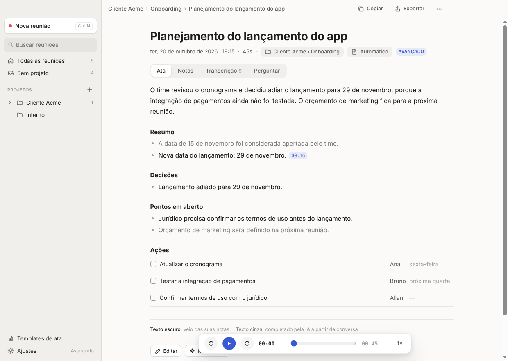
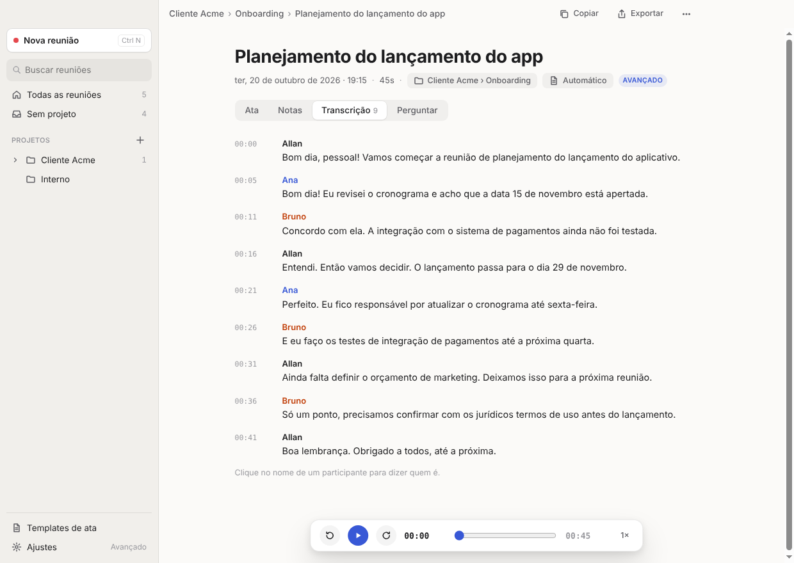
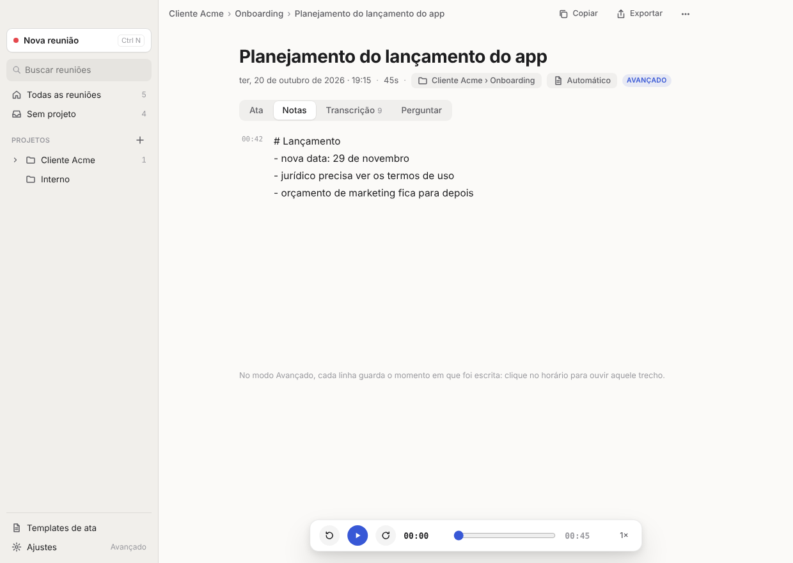
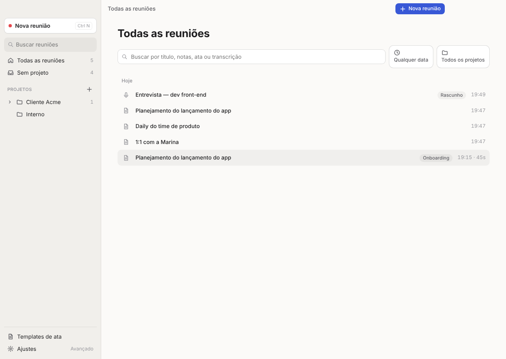
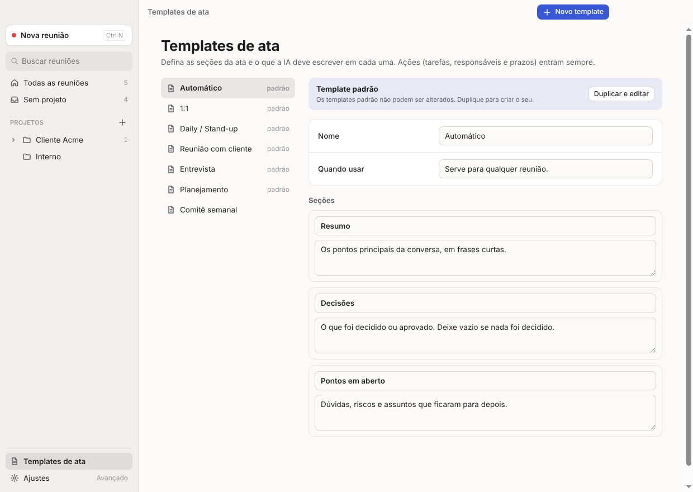
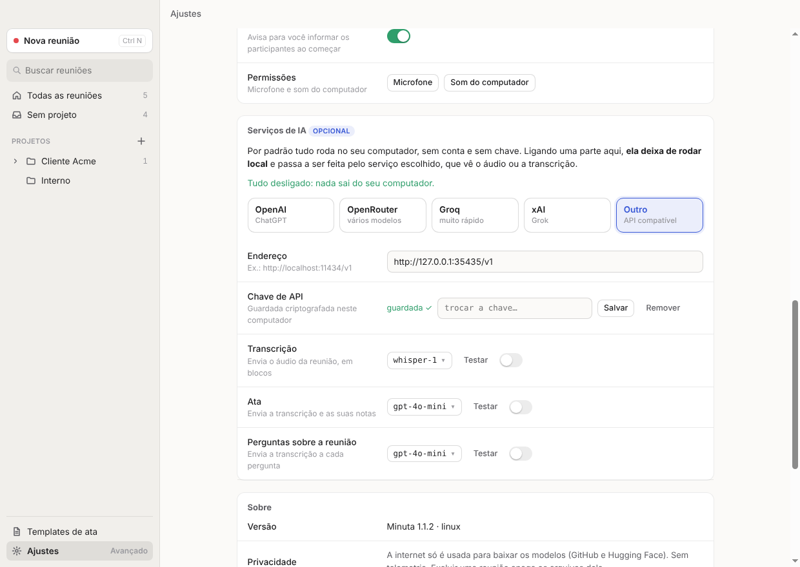
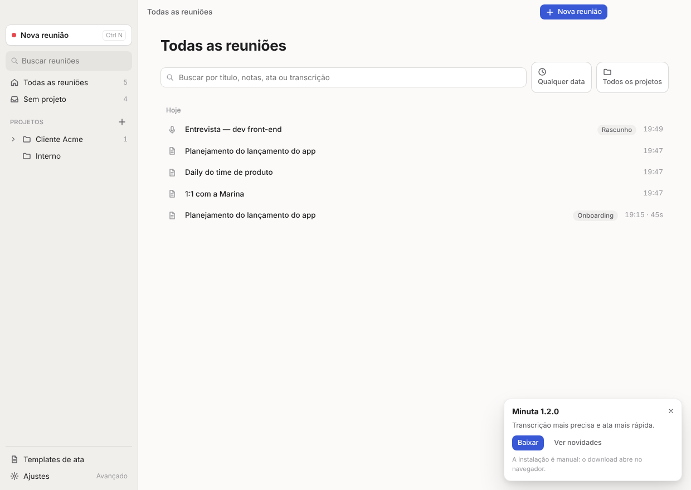
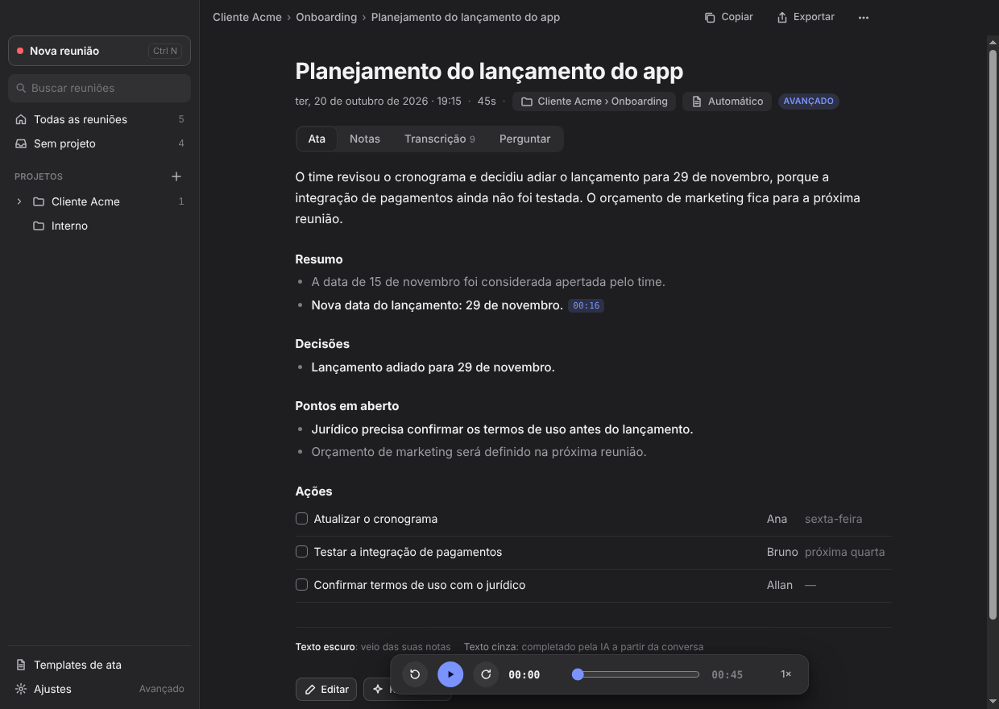

# Minuta

App desktop (Windows e macOS) que grava reuniões, transcreve, separa as vozes e escreve a ata com IA **local**.
Sem robô entrando na call, sem conta, sem chave de API: o áudio, a transcrição e a ata ficam numa pasta sua.

**[⬇ Baixar a última versão](https://github.com/allanthalisson/minuta/releases/latest)** · [como instalar](INSTALAR.md) · [decisões de interface](docs/UX-DOSSIE.md)



Você anota só o essencial durante a reunião e a ata parte dessas notas: **o que você escreveu aparece em texto escuro,
o que a IA completou a partir da conversa aparece em cinza**. Cada item leva ao trecho da gravação de onde veio.
*(a ata acima é um exemplo escrito à mão, para mostrar o layout)*

## As telas

| | |
|---|---|
|  **Transcrição com as vozes separadas.** No modo Avançado o app agrupa as falas por voz e você dá nome a cada participante. Clicar no horário toca aquele trecho. *(saída real do reconhecedor)* |  **Suas notas durante a reunião.** No modo Avançado cada linha guarda o horário em que foi escrita, e a ata usa esses pontos como base. |
|  **Tudo organizado.** Projetos e subprojetos, busca pelo conteúdo da ata e da transcrição, e filtros por data e por projeto. |  **Templates de ata.** Seis prontos e um editor para criar os seus. Trocar o template refaz a ata sem reprocessar o áudio. |
|  **Serviços de IA opcionais.** Dá para apontar transcrição, ata ou perguntas para OpenAI, OpenRouter, Groq, xAI ou um servidor seu. Tudo desligado = tudo local. |  **Avisa quando sai versão nova.** No Windows baixa e instala sozinho; no Mac abre a página do download. |

Modo escuro também:



## Como funciona
```
Interface (renderer, sandbox)  ── IPC ──  Processo principal (Electron)  ── mensagens ──  Motor (utilityProcess)
 microfone + som do computador            arquivos, projetos, fila,                      VAD Silero + Parakeet v3 (sherpa-onnx)
 AudioWorklet → PCM 16 kHz por faixa      downloads dos modelos, menus                    embeddings 3D-Speaker → agrupamento de vozes
                                                                                         LLM Qwen (node-llama-cpp) → ata em JSON
```
- **Captura sem seletor:** o processo principal libera o *loopback* do sistema em `setDisplayMediaRequestHandler`.
  Sua voz e a call ficam em faixas separadas e alinhadas pelo relógio de áudio.
- **Transcrição ao vivo:** cada trecho de fala detectado pelo VAD é transcrito durante a reunião, então ao encerrar sobra pouco a fazer.
  - O VAD usa silêncio mínimo diferente por faixa: 0,6 s no microfone (é sempre a mesma pessoa, então frases separadas por
    pausas curtas viram um trecho só, com mais contexto para o reconhecedor) e 0,25 s na call (lá há várias pessoas, e juntar
    vozes diferentes atrapalharia a separação). Medido com reunião sintética em pt-BR: WER do microfone 9,3% → 7,0%.
  - As falas entram na tela pela ordem do relógio da gravação, não pela ordem em que o reconhecedor termina — uma fala curta
    que interrompe outra, longa, é reconhecida antes, e sem isso apareceria fora de ordem.
- **Vozes (Avançado):** a faixa do microfone é sempre "você". Na faixa da call, cada fala gera um embedding, e as falas
  são agrupadas por similaridade de cosseno. Ecos da call que vazaram no microfone são descartados por comparação de texto e tempo.
- **Ata:** o template vira um JSON Schema e o modelo é forçado por gramática a responder nesse formato.
  - Reuniões longas são lidas em blocos e depois sintetizadas.
  - Cada item é ligado às suas notas (texto escuro) e ao trecho da transcrição (botão de horário).
  - Notas que o modelo ignorou entram em "Suas notas", para nada se perder.

## Desenvolvimento
```bash
npm install
npm start                 # abre o app
npm test                  # testes unitários (sem modelos)
```
Testes de ponta a ponta, com modelos reais de transcrição e vozes sintéticas, no Linux com xvfb:
```bash
node test/make-meeting.js                 # gera a reunião sintética (precisa das vozes Piper em $MODELS)
xvfb-run -a node test/e2e.js              # Electron real: onboarding, gravação, transcrição, vozes, ata, filtros, templates
PACKAGED=build/stage-linux-x64/dist/linux-unpacked/minuta xvfb-run -a node test/e2e.js   # o mesmo no app empacotado
xvfb-run -a node test/showcase.js         # regera as capturas de tela do README em docs/img
```

## Gerar os instaladores
```bash
# Windows (.exe NSIS) — funciona em Linux, macOS ou Windows; não precisa de Wine
node build/stage.js win32 x64 && node build/build.js win32 x64

# macOS no próprio Mac (.dmg + .zip; assina e notariza se houver CSC_LINK/APPLE_ID configurados)
node build/stage.js darwin arm64 && node build/build.js darwin arm64

# macOS a partir do Linux (.zip com assinatura ad-hoc via rcodesign)
RCODESIGN=/caminho/rcodesign build/pack-mac-on-linux.sh arm64
```
O workflow `.github/workflows/release.yml` faz tudo isso em máquinas Windows e macOS do GitHub.

## Serviço de IA opcional
Em Ajustes dá para apontar transcrição, ata e perguntas para um serviço compatível com a API da OpenAI, cada uma
com seu próprio modelo e seu próprio liga/desliga. Tudo desligado (o padrão) = só os modelos do computador.
- Cliente em [src/shared/cloud.js](src/shared/cloud.js): chat (com streaming e `json_schema`), transcrição
  (`multipart`, `verbose_json`) e listagem de modelos, com repetição automática em 429/5xx e mensagens de erro em português.
- A ata e as perguntas reaproveitam `AtaWriter.write()/chat()` por meio de `CloudWriter`, que só troca o `ask()`.
- A transcrição pela nuvem envia cada faixa separada em blocos de até 4 minutos, cortados num ponto de silêncio;
  os horários voltam deslocados e a separação de vozes continua sendo feita localmente por embeddings.
- A chave fica criptografada com `safeStorage` num arquivo próprio em `userData`, nunca é enviada ao renderer nem ao log.
- O endereço de um serviço conhecido vem sempre do preset; `ai.baseUrl` só vale para "Outro" (senão um endereço guardado
  antes sobrevivia à troca de serviço e a chave de um ia parar no outro).
- O seletor de modelo mostra as sugestões do serviço escolhido e, quando há chave, a lista real de `/models`,
  filtrada por tipo (só modelos de áudio na transcrição).
- Falha no serviço → o processamento termina com o modelo do computador.
- Testes: [test/cloud.js](test/cloud.js) e a seção de IA do e2e, ambos contra [test/fake-openai.js](test/fake-openai.js).

## Modelos (baixados no primeiro uso)
| Modelo | Uso | Origem | Licença |
|---|---|---|---|
| Silero VAD | detectar fala | releases do sherpa-onnx (GitHub) | MIT |
| Parakeet TDT 0.6B v3 (int8) | transcrição, 25 idiomas | releases do sherpa-onnx (GitHub) | CC-BY-4.0 |
| 3D-Speaker ERes2Net | separar vozes (Avançado) | releases do sherpa-onnx (GitHub) | Apache-2.0 |
| Qwen2.5-1.5B-Instruct Q4_K_M | ata (Light) | Hugging Face (Qwen) | Apache-2.0 |
| Qwen3-4B-Instruct-2507 Q4_K_M | ata (Avançado) | Hugging Face (unsloth) | Apache-2.0 |
